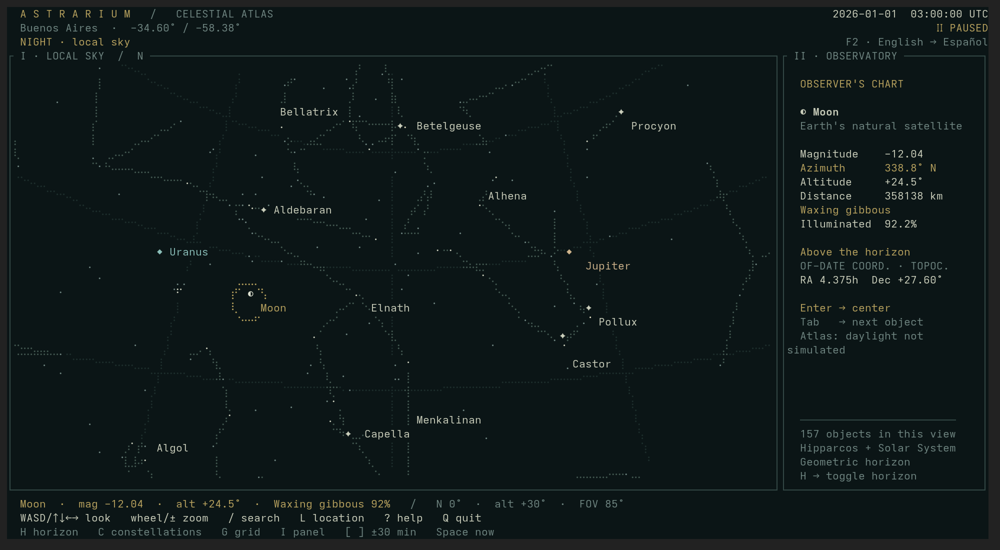

<p align="center">
  
</p>

# Astrarium

**A small atlas of an immense sky. Right in your terminal.**

[](https://github.com/laflechaenelaire/astrarium/actions/workflows/ci.yml)
[](https://www.rust-lang.org/)
[](LICENSE)

An **offline terminal planetarium written in Rust**, with the feel of an old
astronomical chart: dark green, ivory and muted gold. Built on
[Omarchy](https://omarchy.org/), using standard terminal rendering.



*A real Alacritty capture. Buenos Aires, 2026-01-01 at 03:00 UTC; time paused.*

- **Your sky:** 5,044 stars, 88 constellation figures and positions from your location.
- **The Solar System:** seven planets, Sun, Moon, lunar phases and illumination.
- **Explore naturally:** drag to look around, scroll to zoom, click to inspect.
- **Discover as you zoom:** progressive names, designations and HIP identifiers.
- **Go beyond the horizon:** a full-sky mode lets you look all the way down.
- **Offline and bilingual:** embedded data, English by default, Spanish with F2.

[Start](#start) · [Controls](#controls) · [Languages](#language) · [Contributing](CONTRIBUTING.md) · [Changelog](CHANGELOG.md)

## Start

You need stable Rust, a C compiler and Clang/libclang for the initial build
([details](#build-and-install)). The resulting binary works offline.

```sh
git clone https://github.com/laflechaenelaire/astrarium.git
cd astrarium
cargo run --release --locked
# With mise:
mise exec rust@stable -- cargo run --release --locked
```

On first launch, enter your location as `Name; latitude; longitude`.
Use `Ctrl+U` to clear the field, for example:

```text
Buenos Aires; -34.6037; -58.3816
```

This is an example, not a detected location. South and west are negative;
use a decimal point. `Enter` saves to
`$XDG_CONFIG_HOME/astrarium/location.json` (usually `~/.config/astrarium/location.json`).
`Esc` keeps the current location; a fresh installation defaults to Greenwich.
There is no automatic geolocation or online city lookup.

Supply a temporary location or a specific RFC 3339 time:

```sh
astrarium --lat=-34.6037 --lon=-58.3816 --location 'Buenos Aires'
astrarium --lat=0 --lon=0 --at=2026-01-01T00:00:00Z
```

## Language

**English is the default.** Press **`F2`** to switch between English and Spanish
and remember your choice, including while a dialog is open.

```sh
astrarium --lang es  # Spanish for this run
astrarium --lang en  # English for this run
```

Precedence: `--lang` → saved preference → English. The CLI override does not
modify preferences. F2 saves to `$XDG_CONFIG_HOME/astrarium/preferences.json`
(usually `~/.config/astrarium/preferences.json`). Invalid or missing preferences
fall back to English, regardless of the system locale.

The interface, solar-system names, lunar phases, compass and location-validation
messages are translated. Star catalogue names and user-entered location names
are preserved. Search always accepts both languages, including `Moon`/`Luna`,
`Sun`/`Sol`, and `Jupiter`/`Júpiter`. CLI help and argument-parsing errors are in English.

## Controls

| Control | Action |
|---|---|
| Left-button drag | Look around while keeping the horizon level |
| Arrows / WASD | Look around; Shift moves faster |
| Wheel / `+` / `-` | Zoom, 12°–130° horizontal field of view |
| Click | Select a nearby object |
| Tab / Shift+Tab | Cycle through objects in view by brightness |
| Enter | Center the selected object |
| `/` | Search names, HIP identifiers or constellation abbreviations |
| `L` | Set and save location |
| `F2` | Switch English/Spanish and save preference |
| `C` / `G` / `N` | Toggle constellations / grid / automatic labels |
| `H` | Local sky / full sky without horizon |
| `I` | Toggle sidebar |
| `[` / `]` | Step backward/forward 30 minutes and pause |
| `P` | Pause / resume at the current time |
| Space | Return to the current sky |
| Home | Reset view facing north |
| `?` / F1 | Help |
| Esc | Close a dialog; from the sky, quit |
| `Q` / Ctrl+C | Quit; Ctrl+C also works in dialogs |

Search examples: `Sirius`, `Betelgeuse`, `HIP 32349`, `Ori`, `Moon`, `Saturn`.
Opening search with no query lists the nine solar-system objects first.

### Full sky

Press `H` or start with `astrarium --no-horizon` to hide the horizon and
decorative terrain. Look all around the celestial sphere, from the zenith
(+90°) to the nadir (-90°). Objects below ground are shown and can be centered;
their information still reports their real negative altitude. This is a
perspective view explored by turning, not a simultaneous whole-sky map.

Press `H` again for local sky: objects below the horizon are hidden and the
camera's downward tilt is limited to -25°. `G` hides the grid in either mode.

### Progressive labels

| Horizontal field of view | Star labels |
|---|---|
| Wider than 75° | Bright proper names, magnitude ≤2.6 |
| 75° or less | More proper names, magnitude ≤3.8 |
| 45° or less | Names and designations such as `β Ori`, magnitude ≤5 |
| 25° or less | Faint stars and HIP identifiers, down to magnitude 6 |

Label density adapts to terminal size and avoids overlap. Labels retain their
chosen side while space permits; a 3° zoom-out margin reduces threshold flicker.
The selected object has priority, followed by solar-system objects and bright
stars. `N` hides automatic labels but keeps the selected object's name.

## Astronomy and rendering

- Bundled Hipparcos-derived catalogue: 5,044 stars to magnitude 6, 89 line
  groups for 88 constellations (Serpens has two parts).
- Stellar precession from J2000, local sidereal time, azimuth and altitude.
- Offline solar-system ephemerides using statically linked
  [Astronomy Engine](https://github.com/cosinekitty/astronomy), including
  topocentric lunar parallax. Observer elevation is assumed to be sea level.
- Mercury, Venus, Mars, Jupiter, Saturn, Uranus, Neptune, the Sun and the Moon
  have positions, magnitudes and observer distances (AU; kilometres for the Moon).
- Eight approximate lunar phase names plus geocentric illuminated percentage.
- Day and civil/nautical/astronomical twilight indicator, based on the geometric
  solar centre at 0°, -6°, -12° and -18°. This is not a refracted sunrise calculation.

Azimuth runs clockwise from north. Dates are displayed numerically in UTC;
`--at` accepts RFC 3339 offsets. Supported exploration years: 1900–2100.

This is a visual atlas, not a precision telescope-pointing tool. Stellar
positions omit nutation, aberration and proper motion. Solar-system coordinates
are of-date and include the engine's light-time, precession, nutation and
aberration corrections. Atmospheric refraction is disabled.

Daylight and light pollution are not simulated: objects are plotted during the
day as well. Uranus and Neptune appear even if instruments would be needed.
Terrain contours are decorative, not actual mountains. Body symbols are not
angular-size discs; the Moon symbol does not represent local limb orientation.
Stellar distances are not included.

## Terminals

Unicode/braille and 24-bit colour via Ratatui/Crossterm, designed for Alacritty,
Ghostty, Kitty, WezTerm and other modern terminals supporting SGR mouse events.
No Kitty Graphics or Sixel requirement. Keyboard alternatives are available.

Locally exercised in **Alacritty on Omarchy**. Other terminal emulators use the
same standard rendering/input backend; compatibility reports are welcome.

- Recommended: **120 × 36 cells or larger**; minimum 52 × 18.
- The sidebar hides below 106 columns. Use a monospaced font with braille glyphs.
- `--ascii` uses dot plotting; interface text remains Unicode.
- Rendering assumes cells roughly twice as tall as wide; mouse precision is cell-based.
- SSH/tmux must pass through mouse events and colour.

## Build and install

Requires Rust, a C compiler and Clang/libclang for build-time bindings. On Arch:
`base-devel`, `rust` (or mise/rustup) and `clang`. Clang is not needed at runtime.

```sh
cargo build --release --locked
install -Dm755 target/release/astrarium ~/.local/bin/astrarium
astrarium
```

The initial build downloads dependencies. The resulting binary works offline.

### Arch / Omarchy

A local `PKGBUILD` and `Terminal=true` desktop entry are provided:

```sh
make dist
cd dist
makepkg -si
```

This builds a local Arch package; it does not publish to AUR or imply official
Omarchy inclusion.

## Development

See [CONTRIBUTING.md](CONTRIBUTING.md) for the code map, local setup and how to
report changes to astronomical calculations.

```sh
cargo fmt --check
cargo clippy --all-targets -- -D warnings
cargo test --locked
cargo run -- --check
python3 scripts/smoke.py target/release/astrarium
```

Tests cover NASA/JPL reference positions, lunar phases, projection, horizon
clipping, selection, progressive labels, both languages, persistence and
responsive layouts. The PTY smoke test uses an isolated configuration directory
and exercises keyboard/mouse controls and terminal restoration.

See [ephemeris references](data/ephemeris-validation.md) and
[catalogue provenance](data/README.md). `python3 scripts/catalog.py` regenerates
the catalogue from d3-celestial and needs a network connection; it is not part
of normal builds or runtime.

Code: MIT. Catalogue: [BSD-3-Clause](data/LICENSE-d3-celestial).
Astronomy Engine: [MIT](data/LICENSE-astronomy-engine).

## Credits

Made by [Santiago González](https://github.com/laflechaenelaire) and contributors.
Built with [Ratatui](https://ratatui.rs/), [Crossterm](https://github.com/crossterm-rs/crossterm),
[Astronomy Engine](https://github.com/cosinekitty/astronomy) and
[d3-celestial's catalogue](https://github.com/ofrohn/d3-celestial).

Release and publishing instructions: [docs/releasing.md](docs/releasing.md).
